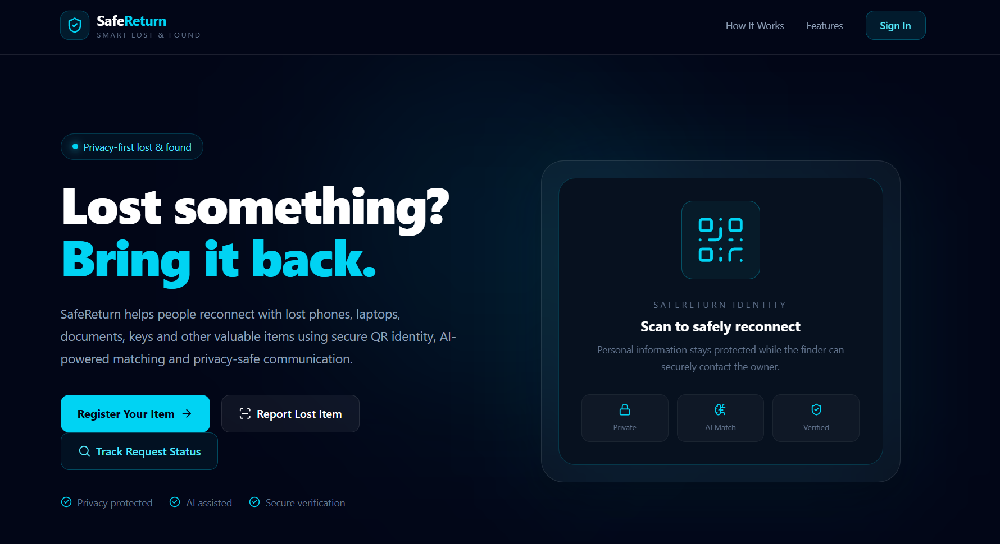
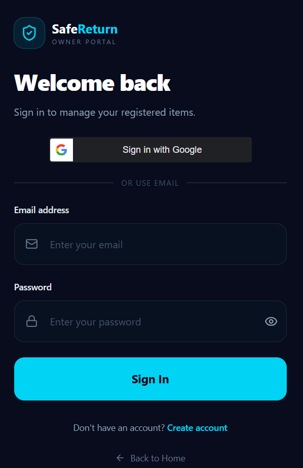
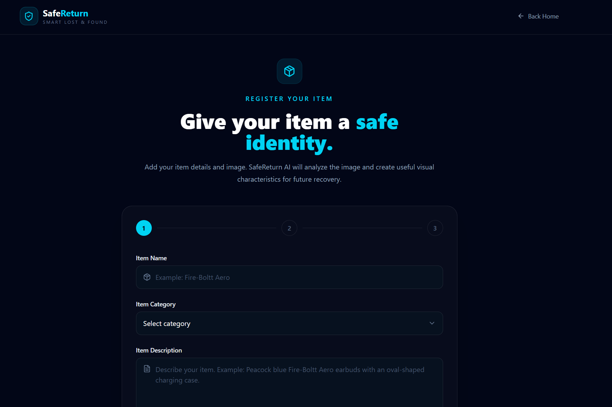
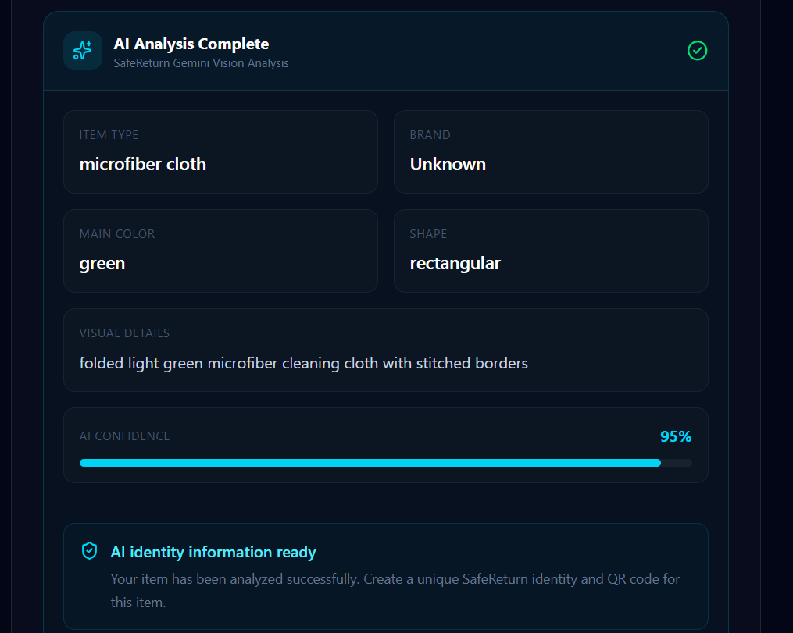
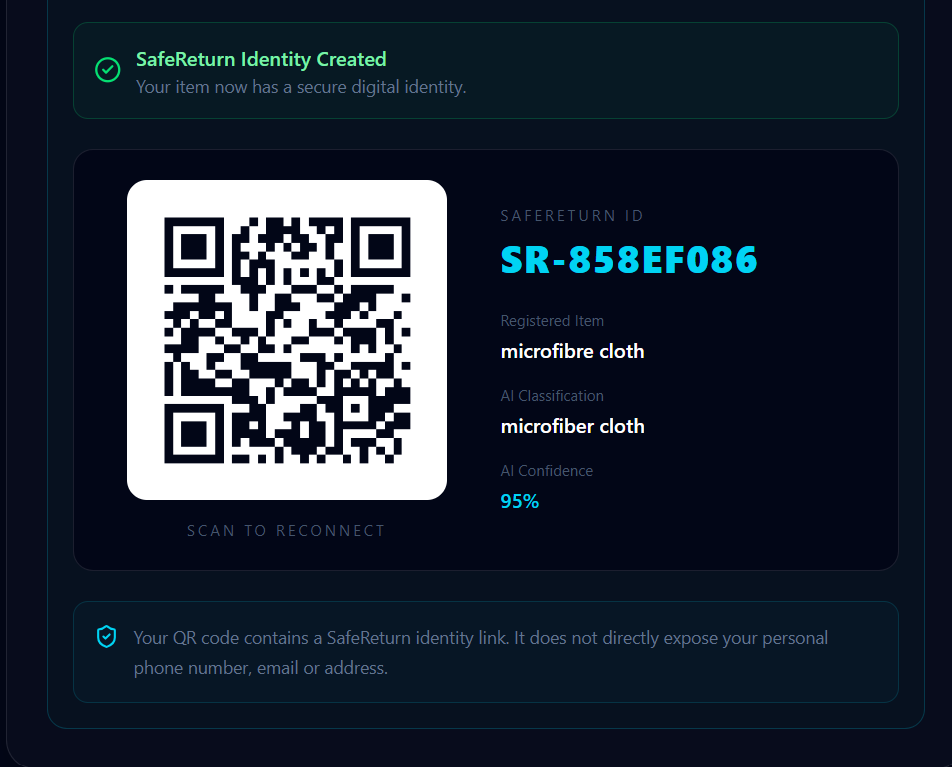
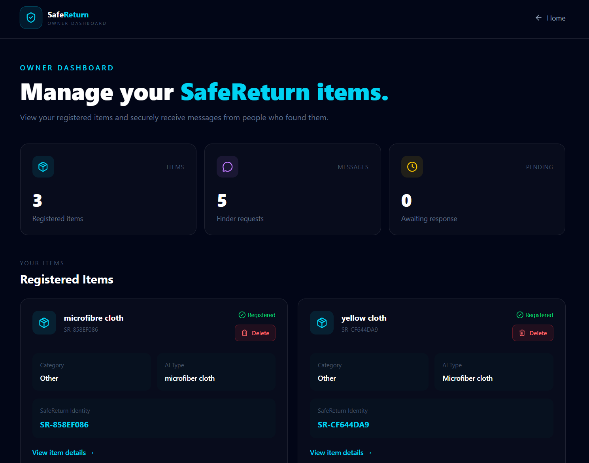
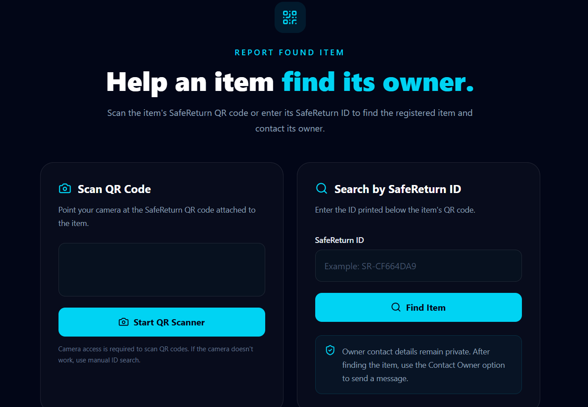

# 🛡️ SafeReturn
### AI-Powered Lost & Found Platform

**Helping people recover their lost belongings through AI, QR technology, and secure communication.**

## 📖 About the Project

SafeReturn is a full-stack web application designed to simplify the process of recovering lost belongings.

The platform connects people who have lost their belongings with people who have found them. It integrates AI-powered image analysis, QR code generation and scanning, secure authentication, item tracking, and notifications into a unified application.

Instead of relying entirely on manual searches, users can register items, identify them using a unique SafeReturn ID, contact item owners, and track requests through an organized dashboard.

### 🎯 Project Objectives

- Simplify the lost-and-found process.
- Use AI to assist with item image analysis.
- Enable convenient item identification through QR codes.
- Provide a communication channel between finders and owners.
- Help users monitor requests and item recovery status.

---

## 📸 Project Screenshots

### 🏠 Home Page



### 🔐 Authentication



### 📝 Item Registration



### 🤖 AI-Powered Item Analysis



### 📱 QR Code Generation



### 📊 Owner Dashboard



### 🔎 Item Search and Tracking



---

## ✨ Key Features

### 🤖 AI-Powered Item Analysis
- Integrates the Google Gemini API for image-based item analysis.
- Helps users analyze uploaded item images.
- Supports the item registration workflow.

### 🔐 User Authentication
- Supports Google Sign-In.
- Provides user registration and login functionality.
- Protects item registration and other configured routes.

### 📝 Item Registration
- Allows authenticated users to register items.
- Creates a unique SafeReturn identity for registered items.
- Stores item information in the database.

### 📱 QR Code Technology
- Generates QR codes for item identification.
- Provides a QR scanning interface.
- Supports QR-based item lookup.

### 🔎 Item Search and Tracking
- Supports searching through SafeReturn IDs.
- Allows users to track request status.
- Helps users follow the progress of their requests.

### 📩 Contact Owner
- Allows finders to send contact requests to item owners.
- Displays received requests in the owner dashboard.
- Supports request management.

### 📊 Owner Dashboard
- Displays incoming contact requests.
- Supports request status updates, including Pending, Reviewed, and Resolved.
- Allows owners to delete requests.

### 🔔 Notifications
- Provides in-app notifications.
- Integrates email notifications through the Resend API.
- Helps owners stay informed about incoming requests.

---

## 🛠️ Technology Stack

| Category | Technologies |
|---|---|
| Frontend | React.js, JavaScript |
| Build Tool | Vite |
| Styling | Tailwind CSS |
| Backend | Node.js, Express.js |
| Database | MongoDB Atlas |
| AI Integration | Google Gemini API |
| Authentication | JWT, Google Sign-In |
| QR Functionality | QR Code Generation and Scanning |
| Email Notifications | Resend API |
| Development Tools | Visual Studio Code, Git, GitHub |

---

## 🏗️ Application Architecture

```text
                         ┌────────────────────────┐
                         │         Users          │
                         └────────────┬───────────┘
                                      │
                                      ▼
                         ┌────────────────────────┐
                         │    React Frontend      │
                         │       + Vite           │
                         └────────────┬───────────┘
                                      │
                               HTTP Requests
                                      │
                                      ▼
                         ┌────────────────────────┐
                         │    Node.js + Express   │
                         │      REST APIs         │
                         └────────────┬───────────┘
                                      │
                    ┌─────────────────┼─────────────────┐
                    │                 │                 │
                    ▼                 ▼                 ▼
           ┌────────────────┐ ┌──────────────┐ ┌────────────────┐
           │ MongoDB Atlas  │ │ Gemini API   │ │  Resend API    │
           │ Item & Request │ │ Image        │ │ Email          │
           │ Data           │ │ Analysis     │ │ Notifications  │
           └────────────────┘ └──────────────┘ └────────────────┘
```

---

## 🔄 How It Works

1. **Sign Up / Login** — Users authenticate before accessing protected item-registration features.
2. **Register an Item** — The authenticated user uploads an item image.
3. **AI Analysis** — The application sends the image for AI-powered analysis.
4. **Save Item Details** — The user completes the registration process and obtains a SafeReturn ID.
5. **Find an Item** — A finder can use the available QR or SafeReturn ID lookup functionality.
6. **Contact the Owner** — The finder sends a contact request.
7. **Manage Requests** — The owner reviews and updates the request status.
8. **Track Progress** — Users can follow the available request-tracking functionality.

---

## 📂 Project Structure

```text
SafeReturn/
│
├── safereturn/
│   ├── public/
│   ├── src/
│   │   ├── pages/
│   │   ├── App.jsx
│   │   └── main.jsx
│   ├── .env
│   ├── package.json
│   └── vite.config.js
│
├── server/
│   ├── middleware/
│   ├── server.js
│   ├── package.json
│   └── .env
│
├── screenshots/
│   ├── home.png
│   ├── login.png
│   ├── register-item.png
│   ├── ai-analysis.png
│   ├── qr-code.png
│   ├── owner-dashboard.png
│   └── find-track.png
│
├── .gitignore
└── README.md
```

*Note: This structure illustrates the main project components. Adjust the filenames and folders to match the actual repository.*

---

## ⚙️ Installation and Setup

### Prerequisites

Make sure you have the following installed:

- Node.js and npm
- Git
- A MongoDB Atlas account or accessible MongoDB instance
- A Google Gemini API key
- The credentials required by the configured authentication and email services

### 1. Clone the Repository

```bash
git clone YOUR_GITHUB_REPOSITORY_URL
cd SafeReturn
```

Replace `YOUR_GITHUB_REPOSITORY_URL` with your actual GitHub repository URL.

### 2. Install Frontend Dependencies

```bash
cd safereturn
npm install
```

### 3. Install Backend Dependencies

Open another terminal from the project root:

```bash
cd server
npm install
```

### 4. Configure Environment Variables

Create the required environment files locally.

Configure the variables required by the application, such as:

- MongoDB connection string
- Gemini API key
- JWT authentication secret
- Google OAuth credentials
- Resend API key
- Frontend and backend configuration values

Use the exact variable names expected by the application code.

**Never commit real credentials, API keys, database URIs, or secrets to GitHub.**

### 5. Start the Backend

From the `server` directory, use the development command configured in `server/package.json`.

For example, if the project uses Node directly:

```bash
node server.js
```

### 6. Start the Frontend

From the `safereturn` directory:

```bash
npm run dev
```

Open the local URL printed by Vite in your terminal.

> The frontend API base URL and backend configuration must be updated appropriately when deploying to production.

---

## 🔒 Security Considerations

- Keep `.env` files out of version control.
- Never expose private API keys in frontend code.
- Protect restricted API endpoints with appropriate authentication middleware.
- Validate user input on the backend.
- Configure production CORS settings for the intended frontend domain.
- Use HTTPS in production.
- Store authentication secrets securely.

---

## 🧪 Testing Checklist

Before considering the deployment complete, verify the following:

- [ ] User registration works.
- [ ] Email/password login works, if configured.
- [ ] Google Sign-In works.
- [ ] Unauthenticated users cannot access protected item-registration functionality.
- [ ] Authenticated users can analyze item images.
- [ ] Item registration and SafeReturn ID generation work.
- [ ] QR generation and scanning work.
- [ ] SafeReturn ID lookup works.
- [ ] Contact requests reach the owner dashboard.
- [ ] Request status updates work.
- [ ] In-app notifications work.
- [ ] Email notifications work.
- [ ] The application works on mobile and desktop.
- [ ] Production environment variables are configured securely.

---

## 🚀 Deployment

The application can be deployed using services appropriate for its architecture.

| Component | Possible Hosting |
|---|---|
| React Frontend | Vercel |
| Node.js / Express Backend | Render |
| Database | MongoDB Atlas |

Production deployment requires the correct API URLs, environment variables, authentication settings, and CORS configuration.

**Deployment status:** Frontend and backend Successfully deployed.

**Live Demo:** https://safereturn-web-theta.vercel.app
---

| Component | Hosting | URL |
|---|---|---|
| React Frontend | Vercel | https://safereturn-web-theta.vercel.app |
| Node.js / Express Backend | Render | https://http://localhost:5000/ |
| Database | MongoDB Atlas | MongoDB Atlas |

## 🔮 Future Enhancements

- Advanced item-matching functionality.
- Improved item search and filtering.
- More detailed recovery analytics.
- Additional notification preferences.
- Enhanced accessibility and mobile experience.
- More comprehensive automated testing.

---

## 👨‍💻 Developer

Barathkumar P

B.Tech — Computer Science and Engineering (Artificial Intelligence)

Interested in full-stack development, backend engineering, and AI-powered applications.

- GitHub: https://github.com/barath1307

---

### 🛡️ SafeReturn

**Making lost-and-found recovery simpler through technology.**

Built with React, Node.js, MongoDB, and AI integration.

</div>